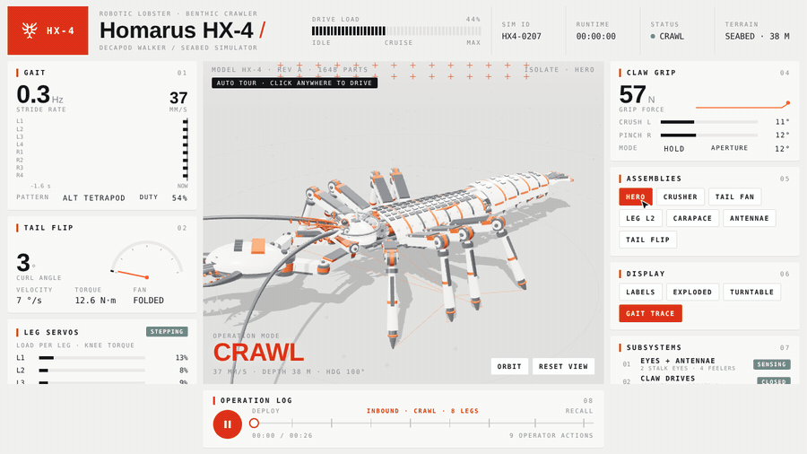

# Homarus HX-4 · robotic lobster

An interactive 3D robotic lobster you can drive, take apart and record, in a single HTML file.

It walks on 8 legs, opens a crusher and a cutter claw, sways two long antennae and escapes with a tail flip. Every subsystem has a button that pulls that part apart while the rest steps aside. Around the 3D view, a console reads live numbers (gait, leg loads, grip force, tail curl), all calculated from the same model that poses the parts. Left alone, the page tours itself with a cursor. Any click hands control to you.



## Run it

Open `index.html` in a browser. There is no build step. three.js r128 loads from a CDN, so the first load needs a network connection.

**Controls:** drag to orbit · scroll to zoom · **Space** tail flip · **X** exploded view · the Assemblies buttons open one part at a time.

## What's in here

| Path | What it is |
|---|---|
| `index.html` | The simulator |
| `lobster.html` | The original reference implementation, kept untouched |
| `CLAUDE.md` | The full design brief: model, geometry, console, tour and the checks |
| `tools/stills.js` | Renders one still per state plus contact sheets into `renders/` |
| `tools/record.js` | Captures the 26 s tour frame by frame on a fixed clock, then encodes MP4 and GIF with ffmpeg into `out/` |
| `tools/vendor/` | Local three.js r128 copies, so the tools run offline |
| `media/` | A recording of the tour |

## Render stills and video

```bash
npm run setup     # Playwright + Chromium
npm run stills    # renders/*.png, contact.png, flip-scrub.png
npm run record    # out/hx4.mp4, out/hx4.gif (needs ffmpeg on PATH, or FFMPEG=<path>)
```

The tools use software WebGL by default, so a full still pass takes about 10 minutes. On Windows, set `GL=gpu` to render on the machine's GPU instead. A 1080p, 60 fps recording then takes about 8 minutes:

```bash
GL=gpu node tools/record.js --size 1920x1080 --fps 60
```

## How it's built

- **One model.** `M` holds the constants in real units: 14 kg, link lengths in metres, servo ratings in N·m. `S` holds the live state. Every pose, gauge and label reads from them; nothing is keyframed by hand.
- **Geometry from code.** There are no model files. About 5,700 primitives (drum servos, chamfered panels, pistons, tapered tubes) are merged per material per part into roughly 500 meshes.
- **Checked numerically.** Besides the stills, the brief's checks (§13) test that nothing goes under the floor in any view, nothing passes through the carapace wall, and claws, legs and antennae don't touch (exact point-in-mesh tests). Collisions are fixed with a number in `M`, never hidden by the camera.

## License

MIT. three.js (in `tools/vendor/`) is MIT, © three.js authors.
